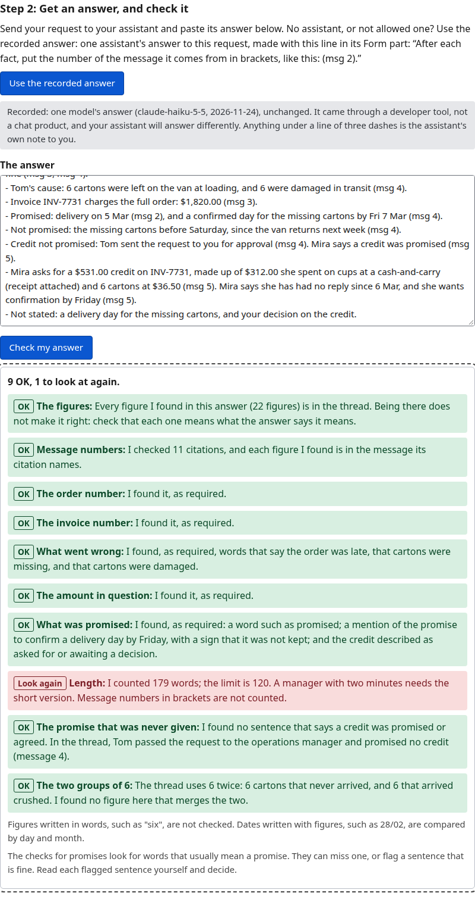

# Practical AI at Work: a workshop kit

After 90 minutes, a participant can brief an AI assistant properly, check what it gives back against the source material, and decide what must never be pasted into it.

**The assistant drafts; you check; you decide.**

A hands-on session for professionals and managers who are not technical. It works with any chat assistant, or with none, and its workbook runs offline from a folder, with nothing to install. Everything in its case is invented.

## What is in the kit

| Folder | What it holds |
|---|---|
| [`participant/`](participant/) | The **workbook** (open `workbook/index.html`; a single-file copy is next to it), the **handout** (three cards on one printable page), and the **case** as plain files. |
| [`instructor/`](instructor/) | The **guide** (what to say, show and expect, exercise by exercise), the minute-by-minute **run sheet**, **when things go wrong**, **variants** for 60 minutes, half a day and online, the **rubric**, and the **answer key**. |
| [`solutions/`](solutions/) | A model answer for every exercise, and why it is strong. |
| [`recorded/`](recorded/) | The exact requests, and the answers the session uses when there is no assistant. Today these are constructed stand-ins; the real recordings are owed. |
| [`tools/`](tools/) | The command-line checker, the build script and the answer runner. |
| [`tests/`](tests/) | The Node tests. |
| [`docs/`](docs/) | [How this kit was tested](docs/HOW-THIS-WAS-TESTED.md). |



*The screenshot above is owed; see [How this kit was tested](docs/HOW-THIS-WAS-TESTED.md).*

## Try it in two minutes

**In a browser:** open `participant/workbook/index.html` by double-clicking it. Go to exercise 2, press *Use the stand-in answer*, then *Check my answer*.

**On the command line** (Node 22 or later, nothing to install): run the stand-in answer of exercise 2 through the checker. The answer is a constructed stand-in, written to contain two mistakes an assistant commonly makes with this thread.

```
node tools/check.js 2 recorded/answers/ex2-answer.txt
```

<!-- pasted from: node tools/check.js 2 recorded/answers/ex2-answer.txt -->
```text
Exercise 2: Summarise, and prove it
8 OK, 2 to look at again.

[OK] The figures: Every figure in this answer (13 figures) is in the thread. Being there does not make it right: check that each one means what the answer says it means.
[Look again] Message numbers: 3 figures cannot be found in the message cited for them. Open that message and the one named below, and correct the citation or the figure.
    - $312.00 is cited to message 4, but it is in message 5.
    - $531.00 is cited to message 4, but it is in message 5.
    - 7731 is cited to message 4, but it is in messages 3 and 5.
[OK] The order number: Found, as required.
[OK] The invoice number: Found, as required.
[OK] What went wrong: Found, as required: it says the order was late, that cartons were missing, and that cartons were damaged.
[OK] The amount in question: Found, as required.
[OK] What was promised: Found, as required: it says what was promised, and it describes the credit as asked for or awaiting a decision.
[OK] Length: I counted 97 words; the limit is 120. Message numbers in brackets are not counted.
[Look again] The promise that was never given: This answer says a credit was promised or agreed. Tom never promised one: he wrote that it must be approved by the operations manager (message 4). Mira writes "the credit you promised" (message 5), but that is her claim, not a promise. Write "Mira says", or say plainly that no credit was promised.
    - Read this sentence: "Tom promised a credit for the 6 damaged cartons (msg 5) and said he would confirm a delivery day for the missing cartons by Friday 7 March, which he did not do (msg 4)."
[OK] The two groups of 6: The thread uses 6 twice: 6 cartons that never arrived, and 6 that arrived crushed. Nothing here merges the two.

Figures written in words, such as "six", are not checked.
The checks for promises look for words that usually mean a promise. They can miss one, or flag a sentence that is fine. Read each flagged sentence yourself and decide.
```

## Who it is for, and what they can do afterwards

**Audience:** professionals and managers who already use, or are about to use, an AI chat assistant at work. Not technical. **Prerequisite:** using a web browser, copying and pasting text. **Group:** 6 to 16 people, each with a laptop. **Length:** 90 minutes, planned.

After the session a participant can:

| # | Objective | Shown by |
|---|---|---|
| O1 | Write a request as a five-part brief: the situation, the material, the task, the form of the answer, the limits | Exercise 1 |
| O2 | Ask for an answer that can be checked, and check its figures and facts against the material | Exercise 2 |
| O3 | Name what is wrong in an answer that looks right: a wrong figure, a fact that is not in the material, a breach of a stated rule | Exercise 3 |
| O4 | Decide what must not be pasted into a public assistant, and prepare a table so that it can be | Exercise 4 |
| O5 | Turn a request that worked into a template a colleague can reuse | Exercise 5 |

**The case.** One invented small business, used in every exercise: a wholesale supplier of cups and packaging, and a bakery owner whose delivery came late, short and partly damaged. Five e-mails over nine days, a one-page returns policy, a thirty-row orders table and eight snippets. The thread holds two traps that careless summaries fall into: a promise the customer asked for and was never given, and one figure that appears twice with two different meanings.

**The lesson flow** (planned minutes):

| Block | What the participant does | Planned minutes |
|---|---|---|
| Welcome and setup | Opens the workbook; meets the case | 5 |
| 1. From a wish to a brief | Reads what a one-line request produces; rewrites it as a five-part brief | 15 |
| 2. Summarise, and prove it | Asks for a summary with a source for every fact; checks every figure against the thread | 20 |
| 3. Find what is wrong | Marks every sentence of three fluent replies: fine, a wrong figure, not in the material, or against the policy | 12 |
| 4. What must not go in | Sorts eight snippets; prepares the orders table with stand-ins and maps the answer back | 20 |
| 5. Make it reusable | Turns the summary request into a template with named placeholders | 8 |
| The ten-question check, and the close | Ten questions, two per objective, each wrong answer explained | 10 |
| **Total** | | **90** |

## How this kit was tested

| Kind of evidence | What it is here | State |
|---|---|---|
| Automated tests | Every checker rule, both ways; the keys agree; no network address in the workbook; the single-file copy is current | Done locally: 177 tests, 177 pass, 0 fail (Windows, Node 24). CI has not run yet. |
| Recorded answers through the checker | Each real model answer is run through the checker in CI, and the result is the one the instructor guide describes | Not yet: the five answers are constructed stand-ins, and the recordings are owed. The stand-ins and the model answers run through the checker and give their expected results. |
| A new-user test by an AI agent | A fresh agent, given the participant folder and nothing else, does every exercise as a first-time participant; its answers go through the checker; every point where it was unsure is listed with what was changed | Not yet done. Owed. |
| An independent review | A reviewer with no part in the build | Not yet done. Owed. |
| Taught to a class of people | | Not done. |

**This kit has not been taught to a class of people.** The details, and the output of the last runs, are in [How this kit was tested](docs/HOW-THIS-WAS-TESTED.md).

To run the tests yourself (Node 22 or later, nothing to install):

```
node --test "tests/*.test.js"
node tools/build.js --check
node tools/run-answers.js
```

## What it does not do

- **It is not a course on any one product.** Every exercise works with any chat assistant, and with none.
- **The checker checks figures and stated facts, not style or judgment.** It looks for simple signs, says what they are, and says so on the page. It can miss an error, and it can flag a sentence that is fine: it points, and the participant decides.
- **A figure written in words is not checked.** "Six" is not read; "6" is.
- **The privacy sorting is a teaching key, not legal advice.** An employer's own policy on AI tools comes first.

## How this was built

Written with Claude Code under the author's direction. Every claim on this page is backed by a test or a command the reader can run: the commands above, and the tests listed in [How this kit was tested](docs/HOW-THIS-WAS-TESTED.md). The case's facts are written once, in `participant/workbook/case-data.js`; the request files, the answer key, the printable case and the single-file workbook are generated from it by `node tools/build.js`, and CI fails if any of them is out of date.

## Licence

The code (every `.js` file and the CI workflow) is under the MIT licence in [`LICENSE`](LICENSE); the teaching text (everything else, including the case, the exercises and the questions inside `participant/workbook/case-data.js`) is under Creative Commons Attribution-NonCommercial 4.0 in [`LICENSE-TEXT.md`](LICENSE-TEXT.md).

Author: Evgeny Blekhman, https://www.linkedin.com/in/evgeny-blekhman/
